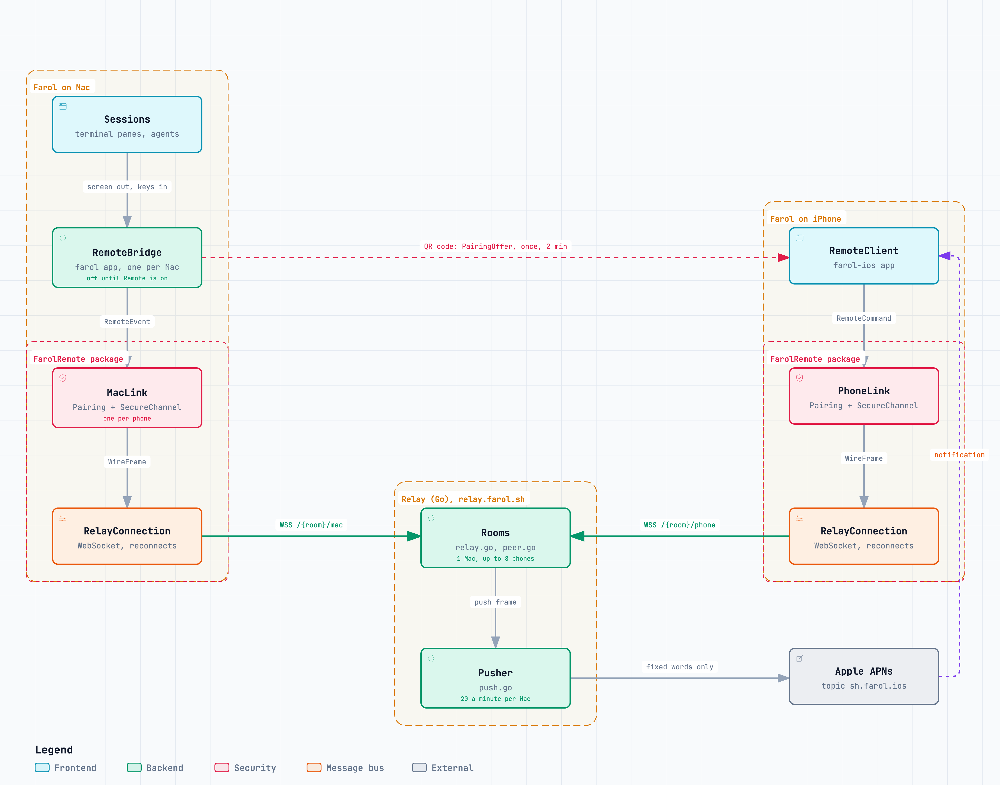

# Farol Remote

Answer your coding agents from your phone. [Farol](https://github.com/snowztech/farol) shows its sessions to a phone you paired and types what you reply. Everything is encrypted between the two, so nothing in between can read it.

## Use it

Pick where your agents run. The phone side is the same for both: open Farol on your iPhone and scan the code.

**On your Mac.** In Farol, open Settings → Remote, turn it on and show the code. The Mac has to stay on.

**On a server that stays on.** For agents that keep working with the Mac closed or off. With tmux installed:

```sh
curl -fsSL https://raw.githubusercontent.com/snowztech/farol-remote/main/install.sh | sh
farol host
```

Every tmux session on that machine is then one the phone can open. The full steps are in [farol/README.md](farol/README.md).

## What is in this repo

Everything that touches security, in one small place to read.

| Folder | What it is | More |
| --- | --- | --- |
| `Sources/FarolRemote` | The Swift package the Mac and iPhone apps share: the messages, pairing and the encryption | |
| `relay/` | The server in between, in Go. It passes bytes it cannot read and stores nothing | [relay/README.md](relay/README.md) |
| `farol/` | The `farol` command for a server, in Go. `farol host` plays the Mac's part there | [farol/README.md](farol/README.md) |
| `Sources/RemoteProbe` | A phone in a terminal, for testing without the iPhone app | |

## How it works



A server running `farol host` takes the place of the Mac in this picture. The relay and the phone do not tell them apart.

## How it is kept private

- A phone is paired by scanning a code on the Mac. The code works once and lasts two minutes, and what makes it valid never reaches the relay.
- After that, each side knows the other's public key. Every connection is encrypted in both directions with HPKE, from Apple's CryptoKit, and tied to numbers made for that connection, so a recording of an older one does not open.
- The relay only ever sees a public key, a room name that is a hash of the Mac's key, and encrypted bytes.

One limit to know: if a Mac's own key were stolen later, traffic recorded from a phone to that Mac could be read. The design has not had an outside review yet.

## Not done yet

- A Mac proves itself to the relay. Today someone who learned a room's name could connect as that Mac and knock the real one off. They could read and send nothing, since the encryption is tied to keys they do not have.
- The relay tells a Mac when Apple no longer knows a phone, so the Mac stops asking to notify one that removed the app.
- An outside review of the pairing and the encryption.

## Work on it

```sh
swift test                      # the package
cd relay && go test -race ./... # the relay
cd farol && go test -race ./... # the farol command
```

## License

[MIT](LICENSE).
