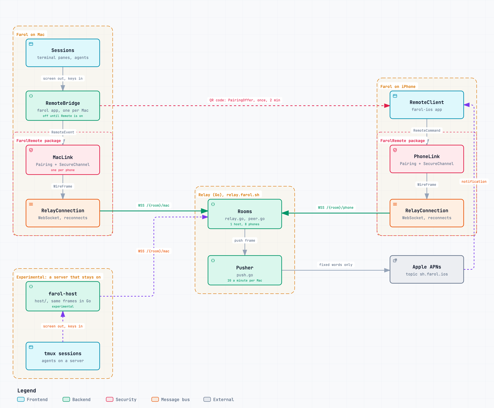

# Architecture

Three programs take part in Remote: a host that owns the sessions, the relay in between, and the phone. The host is Farol on the Mac. A server running `farol-host` can take its place, and is still experimental.

## The parts

| Part | Where | What it does |
| --- | --- | --- |
| **RemoteBridge** | the Farol app on the Mac | Off until Remote is turned on. Sends the session list and the open session's screen, types what the phone sends, and asks for a notification when an agent waits or finishes. |
| **MacLink** and **PhoneLink** | `Sources/FarolRemote` | Pairing and the encrypted channel, one end each. They hold no sockets: frames go in, and what to do about them comes out. |
| **RelayConnection** | `Sources/FarolRemote` | The WebSocket to the relay, on both sides. It comes back by itself after a network change and pings so a dead connection is noticed. |
| **Rooms** | `relay/` | Joins a host with its phones. A room is named by the hash of the host's public key. |
| **Pusher** | `relay/` | Asks Apple to notify a phone. It writes the words itself, so a host cannot make a phone show any text it likes. |
| **RemoteClient** | the Farol for iPhone app | The phone's side: the paired host, the connection, and what the host last said. |
| **farol-host** | `host/`, experimental | Plays the host's part on a server, with tmux windows as its sessions. It speaks the same frames, written again in Go and tested against what the Swift package seals. |

## Messages

The phone sends a `RemoteCommand`, and the host answers with a `RemoteEvent`. Both are in `RemoteMessages.swift`. Each one travels sealed inside a `WireFrame`, and the relay adds one byte in front that says what the frame is: data, joined, left, online, offline or push.

The host always sends the session list and the screen in full, so a phone that missed some has nothing to replay. The screen goes only while the phone shows the terminal, or while the agent waits on something its hooks did not describe. What a waiting agent asks comes as a `request`, and the phone answers it by its id, so a late answer is refused rather than typed into the next prompt. A command carries its own id, so one that arrives twice is carried out once.

How a connection is set up is in [security.md](security.md).
