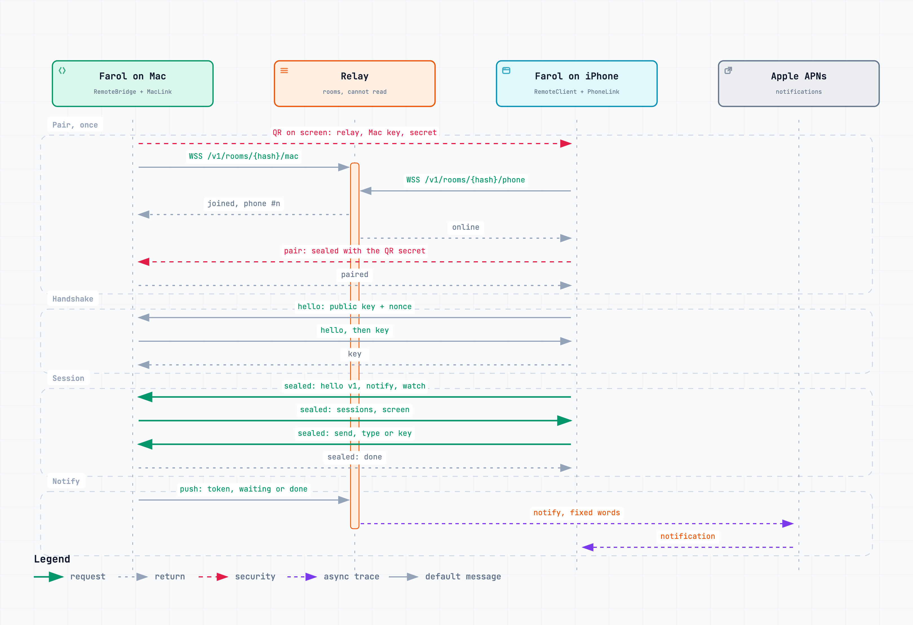

# Security

The relay passes messages it cannot read and keeps none. This page says how, and what is not covered yet.

## Pairing, once

The host shows a QR code. It carries the relay's address, the host's public key and a secret made for that code. The secret never goes to the relay, so the relay cannot pair a device of its own.

The phone answers with one sealed HPKE message, which proves at once that it holds the key it claims and that it knows the secret. A code works once and lasts two minutes. From then on, the host knows the phone's public key and the phone knows the host's.

## Every connection

Each side sends a hello in the clear, with its public key and a number made for this connection. Then each direction becomes an HPKE stream, sealed to the other side's key and signed with its own. Both streams are tied to the two numbers, so a recording of an older connection does not open, and messages open only in the order they were sealed.

## Pictures from the phone

A phone can send a picture for an agent to look at. The Mac takes only a JPEG, PNG or HEIC, read from its first bytes, up to 10 MB. It names the file itself, in a folder only you can read, and removes it after a week. The phone never chooses a path or a file type.

## What the relay sees

- A public key, and a room name that is the hash of the host's key.
- Encrypted bytes, and how many.
- For a notification: the phone's notification token, and whether an agent is waiting or done. Which session it is about travels sealed for the phone alone.

It stores none of it, and its log holds totals only. It also limits what one address or one connection can do, so it is no use as a free tunnel. The limits are in [relay/README.md](../relay/README.md).

## Not covered yet

- If a host's own key were stolen later, traffic recorded from a phone to that host could be read.
- A host does not prove itself to the relay. Someone who learned a room's name could connect as that host and knock the real one off. They could read and send nothing.
- The pairing and the encryption have had no outside review.

These are also in [ROADMAP.md](../ROADMAP.md).
